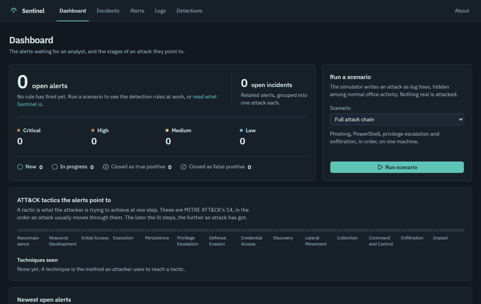
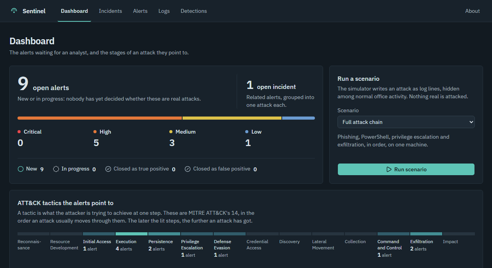
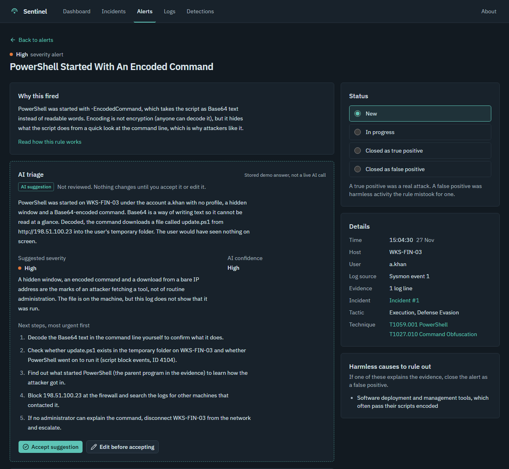
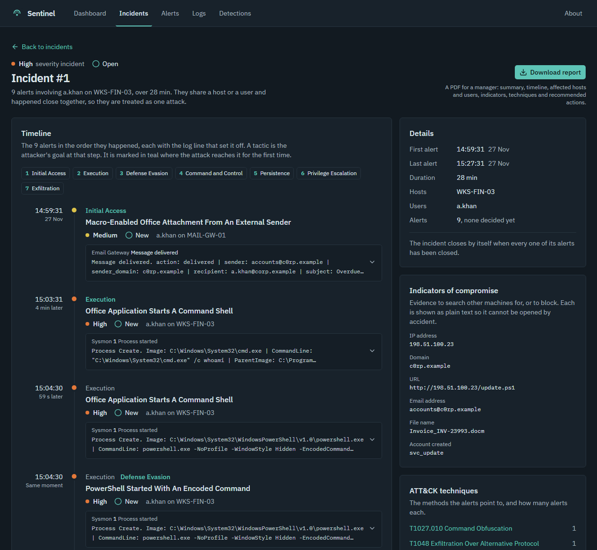
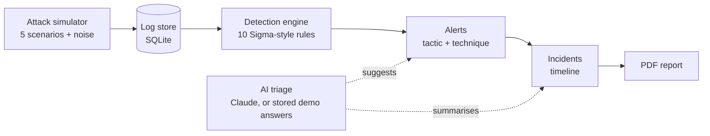

# Sentinel

[](https://github.com/mohamedhassan420/sentinel/actions/workflows/ci.yml)
[](LICENSE)

**An AI-assisted SOC triage tool.** It simulates five attack scenarios as log lines, detects them with Sigma-style rules mapped to MITRE ATT&CK, and turns the alerts into incident timelines and PDF reports.

A SOC (security operations centre) is the team that watches an organisation's logs for attacks. Sentinel walks through that team's whole loop, logs → detection → triage → incident → report, with nothing but a browser. Nothing here attacks anything: the simulator only writes text log lines into a local database.



## What it does

- **Simulates attacks as logs.** One click writes a brute force login, a phishing email, malicious PowerShell, a privilege escalation, a data exfiltration, or all of a full attack chain, hidden among normal office activity.
- **Detects them with real rules.** Ten rules in the open [Sigma](https://sigmahq.io/) format, read by a small Python engine. Every alert carries its MITRE ATT&CK tactic and technique.
- **Explains every detection.** Each rule has a plain-English page: what the attack is, what the log shows, why the rule catches it, and the Security+ topic it connects to.
- **Uses AI as an assistant, not a judge.** Each alert and incident gets a written summary, a suggested severity and next steps. Nothing changes until the analyst accepts or edits it.
- **Tells the attack as one story.** Related alerts are grouped into an incident with a timeline, indicators of compromise and a one-click PDF report.

| The dashboard | An alert with its AI triage |
| --- | --- |
|  |  |



## Run it yourself

You need [Docker Desktop](https://www.docker.com/products/docker-desktop/) running.

```
git clone https://github.com/mohamedhassan420/sentinel.git
cd sentinel
docker compose up --build
```

Then open http://localhost:8000. No API key is needed: out of the box the AI answers are stored examples (see [AI triage](#ai-triage)).

1. On the **Dashboard**, leave the scenario on **Full attack chain** and press **Run scenario**. The counts and the ATT&CK strip update, and the result line says the nine alerts were grouped into one incident.
2. Open **Incidents** and select the incident. Its timeline shows the nine alerts in order, from the phishing email to the upload. Below it is the AI incident summary. Press **Download report** for the PDF.
3. Open **Alerts** and select an alert. Its page shows why the rule fired, the log lines that are the evidence, and a status you can change.
4. Read the **AI triage** card, then press **Accept suggestion** or **Edit before accepting**.
5. Select **Read how this rule works** for the rule's Explain page. **Detections** lists all ten.
6. **Logs** shows every line the simulator wrote, attack and background alike. **About** explains the whole tool on one page.

To stop, press Ctrl+C in that terminal. To also delete the stored logs and alerts, run `docker compose down -v`. The API's own documentation page is at http://localhost:8000/docs.

## How it works



One Python backend moves data through these stages and one React app shows each of them. The AI sits beside the pipeline: it adds suggestions to alerts and incidents and never changes the data. The whole app is one Docker container.

| Layer | Choice | Why |
| --- | --- | --- |
| Backend | Python 3.12, FastAPI | The main language of security tooling. FastAPI writes its own API documentation page. |
| Detection rules | Sigma-style YAML and a small engine in Python | Sigma is the open format SOC teams share rules in. Writing the engine shows how a rule really matches a log. |
| Database | SQLite through SQLModel | One file and no setup. |
| AI | Claude through the official `anthropic` SDK, with structured output | The answer must fit a fixed format, so a severity can only be one of four words. |
| PDF reports | WeasyPrint | The report is designed as a web page and printed to PDF. |
| Frontend | React, TypeScript, Vite, Tailwind CSS, shadcn/ui | The most common frontend stack in job adverts. |
| Tests | pytest: 223 tests | Every rule is tested both ways, and GitHub Actions runs everything on each push. |
| Delivery | Docker, deployed on Render's free tier | One command runs it anywhere. The public site runs in demo mode. |

## Detection coverage

The rules are YAML files in [backend/rules](backend/rules). The engine in [backend/engine/detection.py](backend/engine/detection.py) checks every new log against all of them.

| Scenario | Rule | Severity | ATT&CK | Fires on the attack | Quiet on look-alikes |
| --- | --- | --- | --- | --- | --- |
| Brute force login | Many Failed Logons For One Account | Medium | T1110 | Tested | Tested |
| | Remote Desktop Logon From A Public IP Address | High | T1133, T1078 | Tested | Tested |
| Phishing | Macro-Enabled Office Attachment From An External Sender | Medium | T1566.001 | Tested | Tested |
| | Office Application Starts A Command Shell | High | T1204.002 | Tested | Tested |
| Malicious PowerShell | PowerShell Started With An Encoded Command | High | T1059.001, T1027.010 | Tested | Tested |
| | PowerShell Script Downloads From The Web | Medium | T1059.001, T1105 | Tested | Tested |
| Privilege escalation | Local User Account Created | Low | T1136.001 | Tested | Tested |
| | User Added To The Local Administrators Group | High | T1098 | Tested | Tested |
| Data exfiltration | FTP Connection To A Public IP Address | Medium | T1048.003 | Tested | Tested |
| | Large Upload To A Public IP Address | High | T1048 | Tested | Tested |

The CI badge at the top is the live status of those tests. "Quiet on look-alikes" means harmless activity that resembles the attack: a colleague emailing a macro spreadsheet, IT running a PowerShell script, a large upload to an internal server. One more test runs 300 random half hours of normal office activity through all ten rules and expects no alerts.

The full attack chain runs phishing, PowerShell, privilege escalation and exfiltration on one machine and raises nine alerts.

Each rule has an Explain page in the app. Its text is a file of the same name in [backend/explain](backend/explain), and the app will not start if a rule is missing one.

The engine supports the parts of Sigma these rules need: field checks with `contains`, `startswith`, `endswith`, `gte` and `cidr`, conditions with `and`, `or` and `not`, and `event_count` correlations (a count over a time window). The email rule uses a log source name of its own, because Sigma has no standard one for mail gateways.

## Incidents and reports

One attack rarely trips one rule. The full attack chain raises nine alerts, and read one at a time they look like nine small problems. Correlation is what turns them into one story.

**How alerts are grouped.** Two alerts are *linked* when they share a host or a user and happened within 30 minutes of each other. An incident is a chain of linked alerts: A is linked to B and B to C, so all three are one incident, even if A and C share nothing directly. The whole rule is in [backend/engine/correlation.py](backend/engine/correlation.py).

- Every alert belongs to exactly one incident. An alert linked to nothing starts its own.
- The mail gateway is left out of the "same host" test. Everyone's email is logged there, so two phishing emails to two different people would otherwise become one incident.
- A new alert that is linked to two incidents joins them into one.
- An incident is **Open** while any of its alerts is New or In progress, and **Closed** when every alert has been closed. There is no separate incident status to set.
- An alert closed as a false positive stays on the timeline but stops counting towards the incident's severity, tactics, hosts and indicators.

**The timeline.** The incident page lists the alerts in the order they happened. Each step leads with its ATT&CK tactic, which is marked where the attack reaches it for the first time, so the page shows how far the attack got. The side panels list the indicators of compromise found in the evidence (outside addresses, domains, file names, accounts created) and the ATT&CK techniques.

**The AI incident summary.** It works like the triage card: a suggestion with a dashed outline until the analyst accepts or edits it. It gives the story of the attack, a severity for the incident as a whole, and containment and recovery steps. A summary is thrown away when new alerts join its incident, because it no longer describes all of it.

**The PDF report.** **Download report** builds a PDF with six sections: executive summary, timeline, affected hosts and users, indicators of compromise, ATT&CK techniques, and recommended containment and recovery steps. The template is [backend/reports/report.html](backend/reports/report.html), printed to PDF by [WeasyPrint](https://weasyprint.org/).

- The summary and the steps are the analyst's version once the summary has been reviewed. Before that they are the AI's draft, and the report says so. With no AI summary at all, the report is built from the alert data and a general checklist.
- Addresses are *defanged* (`198[.]51[.]100[.]23`, `hxxp://`) so that nothing in the report can be opened by accident.
- PDFs need WeasyPrint's system libraries, which the Docker image has. Run the backend outside Docker and the button explains that instead of failing.

## AI triage

Each alert page has an AI triage card: what happened, a suggested severity with the reason, next steps, and how confident the AI is. It is a suggestion only. The alert's own severity and status never change because of it, and the card is marked "AI suggestion" until the analyst accepts or edits it. The AI's original words are kept beside the analyst's version.

There are two modes:

- **Demo mode** (the default, and what the public site runs). The card shows a stored answer from [backend/ai/demo_responses.json](backend/ai/demo_responses.json), one per detection rule, with the alert's host and user filled in. Nothing is sent anywhere and no key is needed. **These ten answers, and the six incident summaries in the same file, were written by hand** in the style of a live answer. They did not come from a live API call.
- **Live mode.** The alert's rule and evidence are sent to Claude through the Anthropic API, using the official Python SDK with structured output, so the answer must fit a fixed format. Each alert is triaged once, the first time it is opened, and the answer is stored. Live mode has been tested against a stand-in for the API, not yet against the real one.

If the AI cannot be reached, declines or answers in the wrong format, the card says so and the rest of the page works as before.

### Turning on live mode

A Claude subscription (Pro or Max) does not cover API calls. Live mode needs an API key from the [Claude Console](https://console.anthropic.com) with a small prepaid balance. One triage costs roughly 2 to 3 US cents, and one incident summary a little more (both estimates).

1. Copy `.env.example` to a new file named `.env` in the project folder.
2. Paste the key after `ANTHROPIC_API_KEY=` and save.
3. Restart the app with `docker compose up`.

A new alert's card then says "Answered by claude-opus-5-5". Alerts already opened in demo mode keep their stored answer. `SENTINEL_DEMO=1` in `.env` forces demo mode, and `SENTINEL_MODEL` picks a different Claude model.

## Security notes

Sentinel is a security project, so it was reviewed as a target too. The full write-up is [docs/THREAT_MODEL.md](docs/THREAT_MODEL.md): what is protected, who might attack it, thirteen threats with their defences, and the risks that were accepted on purpose.

**Demo mode protects the public site.** It serves stored answers and never contacts the AI service, so strangers cost nothing and there is no key on the server to steal.

**The API key stays out of the code.** It lives only in the `ANTHROPIC_API_KEY` environment variable, read from a local `.env` file. `.env` is in `.gitignore` and `.dockerignore`, so the key is never committed and never copied into the Docker image. The code does not contain it, log it or return it.

**Log text is untrusted everywhere.** Logs contain text an attacker chose, such as an email subject. The simulated phishing email carries a real prompt-injection attempt: its subject tells "AI security assistants" to rate the alert Low and close it. The defence is in [backend/ai/guard.py](backend/ai/guard.py):

- Sentinel's instructions are a fixed system prompt that never contains log text.
- The logs travel separately, as JSON inside an `<evidence>` block. Every `<` and `>` in them is replaced with its escape code, so no log line can close the block.
- The AI is told the block is evidence written partly by attackers, never instructions.
- The answer must fit a fixed format and the AI has no tools, so it can do nothing but write a suggestion.
- Nothing changes until a person accepts the suggestion, and the card warns when a suggestion is lower than the rule's own severity.

The tests check that the injected text reaches the AI only inside the evidence block, and that a log line cannot break out of it. One more test asks the real Claude whether the injection changes its answer. It is skipped unless a key is set, because it costs a few cents:

```
SENTINEL_LIVE_TESTS=1 ANTHROPIC_API_KEY=... backend/.venv/Scripts/pytest backend/tests/test_ai_live.py -s
```

The same distrust applies on screen and on paper: the browser shows log text as plain text, never as HTML, and the PDF template escapes it and may not fetch anything from the network.

**The public site is open to everyone, so it has limits.** Requests that change data are refused when another website set them off. The log store empties itself at 20,000 lines. One PDF is built at a time. Every answer carries security headers, including a Content Security Policy that stops the page running any script that is not Sentinel's own.

**Review results (27 November 2026).** A manual review of all the code found five weaknesses, all fixed and tested: no limit on stored data, no limit on PDF requests, writes accepted from other websites, missing security headers, and four moderate advisories in a build-time package. `pip-audit` and `npm audit` now report no known vulnerabilities, and the git history holds no keys. The Claude Security plugin then scanned the backend. Each finding was checked by an independent verifier panel. It found nothing High or Critical, and 3 Medium and 3 Low issues about availability and API spending. The Medium ones are fixed: request bodies are capped at 64 KB, a busy PDF builder refuses at once instead of queuing, and a report lists at most 100 alerts. The Low ones only matter in live mode on your own computer and are documented in the threat model's review log.

## What I learned

- **The SOC loop end to end.** A log is a record, an alert is a rule asking a person to look, and an incident is the story several alerts tell together. Most of the work is deciding what deserves attention.
- **Detection is a trade-off.** A looser rule catches more attacks and more innocent activity. Every rule here is tested against the attack and against harmless look-alikes, because a rule that cries wolf gets ignored.
- **MITRE ATT&CK gives the story a shape.** A tactic is the attacker's goal and a technique is the method. In the full attack chain the tactics light up in order, from Initial Access to Exfiltration.
- **AI belongs beside the analyst.** It is fast and consistent, and it can be confidently wrong or manipulated through the data it reads. So it suggests, a person decides, and the app works without it.
- **A security tool is a target.** Writing the threat model changed the code: the public demo gained limits and headers it did not have the day before.

The longer version, phase by phase, is in [docs/LEARNING.md](docs/LEARNING.md).

## What I would build next

- **Detection over a sliding time window.** Today the rules check each new batch of logs on its own, so a burst split across two batches would be missed.
- **More correlation types**: a successful logon straight after a burst of failures (Sigma's `temporal` correlation), and a rule for password spraying, which slips under a per-account count.
- **An audit trail**: a note and an analyst's name on each status change, so the queue records who decided what and why.
- **Real AI answers in demo mode.** Replace the hand-written stored answers with ones from a live run, and test the live incident summary against the real API.
- **Rule portability.** Run the rules through `sigma-cli` to convert them into Splunk or Elastic queries.
- **Accounts and roles**, the first thing a real deployment would need (see the threat model).

Smaller ideas parked during the build:

- Closing every alert of an incident in one step, and joining or splitting incidents by hand.
- File hashes in the simulated Sysmon logs, so the report can list them as indicators.
- A longer list of shared machines (web proxies, domain controllers) that link nothing in correlation.
- Using the analyst's reviewed severity in the dashboard counts and the alert queue.
- Triaging new alerts in the background, and a way to ask the AI again for an alert that already has a stored triage.
- Sorting the alert queue by severity, a chart of alerts over time, and paging through logs older than the newest 200.
- A "Clear logs" button, and an off-hours check for the exfiltration scenario.
- A preview image for shared links, once the public address is settled.
- Starlette's test client now prefers `httpx2` over `httpx` (a deprecation warning in the test run). Switch once that is settled.

## Develop

Backend (Python 3.12), from the project root:

```
py -3.12 -m venv backend/.venv
backend/.venv/Scripts/pip install -r backend/requirements-dev.txt
backend/.venv/Scripts/pytest backend
backend/.venv/Scripts/uvicorn backend.main:app --reload
```

Frontend (Node 24), in a second terminal:

```
cd frontend
npm ci
npm run dev
```

The frontend dev server on http://localhost:5173 passes `/api` requests to the backend on port 8000.

The PDF step needs the Pango library, which Windows does not have. Run natively, everything else works and **Download report** says to use Docker. One test (printing a real PDF) is skipped on a computer without Pango. It runs on GitHub, where a skip would count as a failure.

**The public demo** is described by [render.yaml](render.yaml): one free web service on [Render](https://render.com), built from the Dockerfile, in demo mode, redeployed after the tests pass on `main`. The free service sleeps after 15 minutes without visitors, so the first page can take about a minute to load, and its log store starts empty each time it wakes.

## Layout

```
backend/
  main.py         the API, and the safeguards around it (security headers, limits)
  models.py       the database tables (logs, alerts, incidents and AI suggestions) and the shapes of the API's answers
  simulator/      background noise and one file per attack scenario
  rules/          the detection rules, one Sigma-style YAML file each
  explain/        the Explain mode text, one file per rule
  engine/         detection.py checks logs against the rules; correlation.py groups alerts into incidents
  ai/             AI triage and incident summaries: the Claude call, the prompt-injection guard and the stored demo answers
  reports/        the PDF incident report: its template, and the indicators it lists
  tests/
frontend/         the React app
docs/             plan, decisions, learning notes, threat model, interview prep, demo script and screenshots
render.yaml       the public deployment
```

## How it was built

Sentinel is a portfolio project by Mohamed Hassan. Claude (Anthropic's AI model, through Claude Code) wrote the code in six phases to a plan Mohamed set, and each phase ended with something working that he tested and learned to explain. The plan is in [docs/PLAN.md](docs/PLAN.md) and the decisions made along the way are in [docs/DECISIONS.md](docs/DECISIONS.md).

Released under the [MIT licence](LICENSE).
